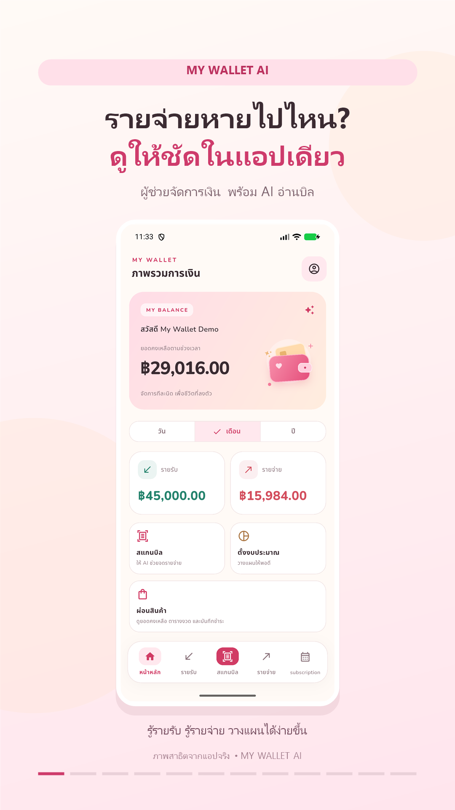
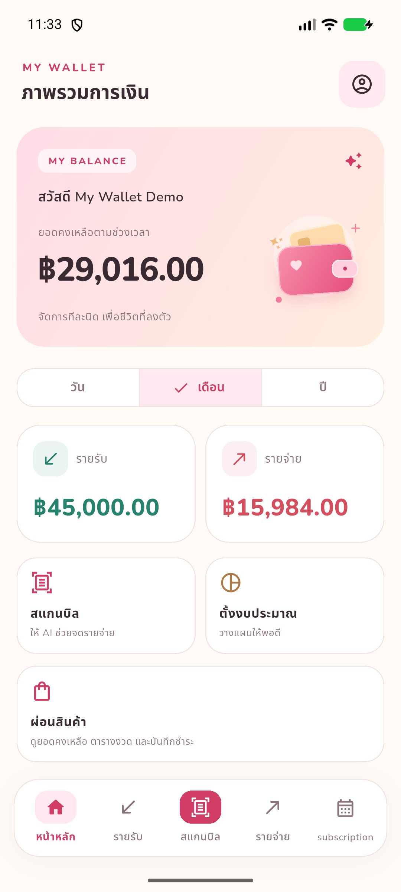
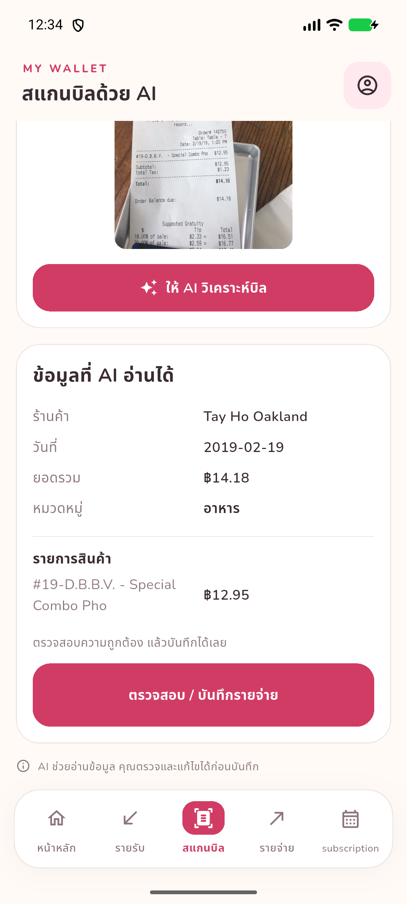
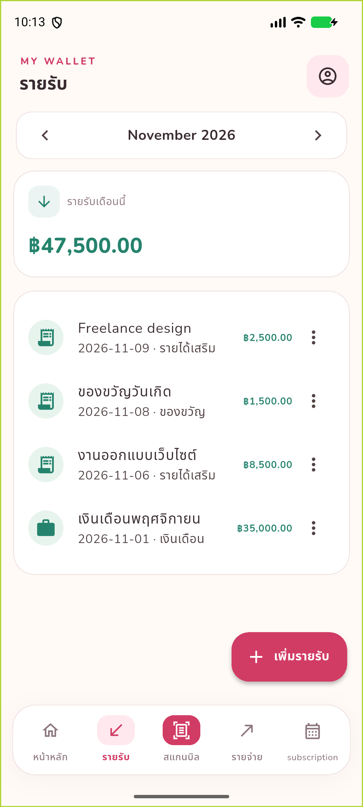
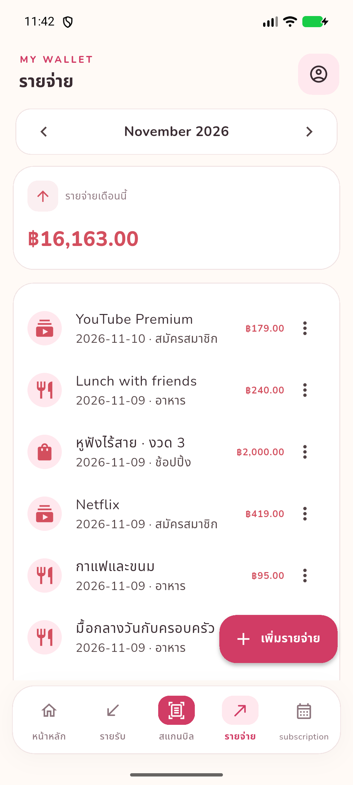
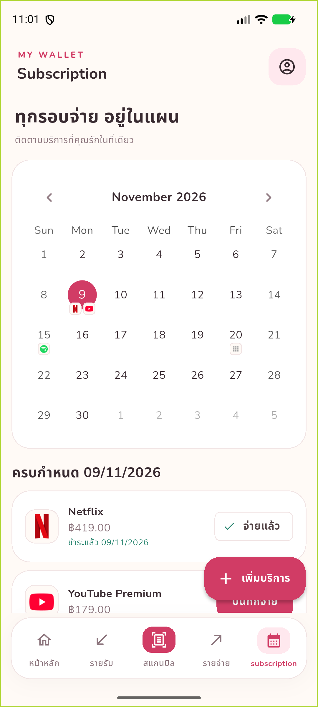
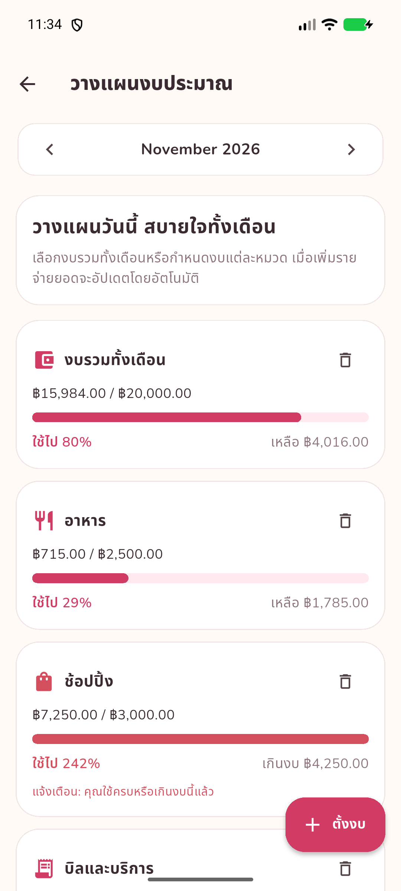
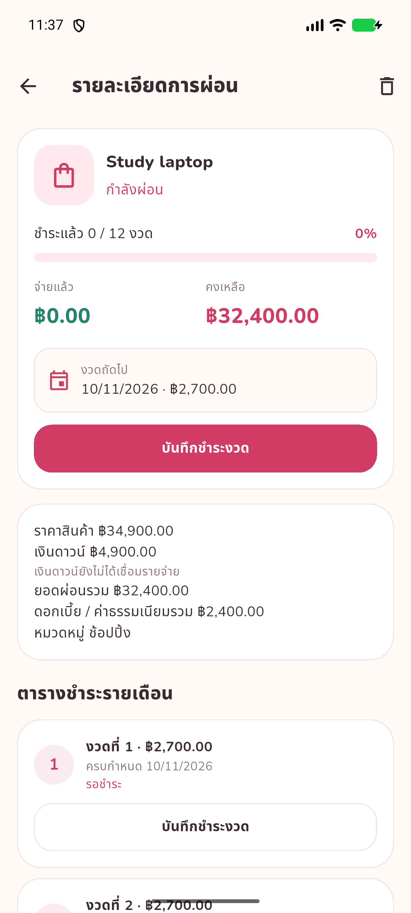

# My Wallet AI — Flutter + PHP + MySQL

โปรเจกต์ตัวอย่างแอปจัดการรายรับ–รายจ่าย **8 Process** พร้อม AI อ่านบิล และปฏิทิน Subscription สำหรับทำโปรเจกต์ Flutter / Dart เชื่อม Backend PHP บน XAMPP

Process ที่ 8 เพิ่มแล้ว: **ผ่อนชำระสินค้า** — เพิ่มสินค้า สร้างตารางงวด บันทึกชำระพร้อมหลักฐาน เชื่อมรายจ่าย และติดตามยอดคงเหลือ ดูรายละเอียดใน [docs/INSTALLMENTS.md](docs/INSTALLMENTS.md)

## วิดีโอแนะนำโปรเจกต์

วิดีโอแนวตั้ง 9:16 ความยาว 60 วินาที พร้อมข้อความไทยและดนตรีบรรเลง จากภาพหน้าจอแอปจริง

[](https://github.com/danuporn-dev/ai-expense-tracker/raw/refs/heads/main/docs/video/My-Wallet-AI-Reels-60s.mp4)

[เปิดหรือดาวน์โหลดวิดีโอ MP4](https://github.com/danuporn-dev/ai-expense-tracker/raw/refs/heads/main/docs/video/My-Wallet-AI-Reels-60s.mp4) · [แคปชันสำหรับโพสต์](docs/video/caption-th.txt) · [รายละเอียดและที่มา](docs/video/README.md)

## ตัวอย่างหน้าจอ

ภาพแคปจากแอปบน Android emulator ด้วยบัญชีและข้อมูลสาธิต ดู [ภาพและขั้นตอนครบทั้ง 8 Process](screenshotforgithub/README.md)

| บัญชีผู้ใช้ | Dashboard |
| --- | --- |
| [](screenshotforgithub/01-auth-welcome.png) | [](screenshotforgithub/02-dashboard-month.png) |

| สแกนบิล AI | รายรับ |
| --- | --- |
| [](screenshotforgithub/03-receipt-result.png) | [](screenshotforgithub/04-income-saved.png) |

| รายจ่าย | Subscription |
| --- | --- |
| [](screenshotforgithub/05-expense-list.png) | [](screenshotforgithub/06-subscription-calendar.png) |

| งบประมาณ | ผ่อนสินค้า |
| --- | --- |
| [](screenshotforgithub/07-budget-overview.png) | [](screenshotforgithub/08-installment-detail.png) |

ภาพชุดนี้แคปวันที่ 9–11 พฤศจิกายน 2026 ขั้นตอน AI มีภาพสแกนบิลใหม่สองใบสำเร็จ ตรวจแก้ข้อมูล บันทึกเป็นรายจ่าย และเปิดดูรูปบิล รายละเอียดอยู่ใน [Process 3](screenshotforgithub/README.md#process-3) พร้อม [บิลตัวอย่างและที่มา](docs/sample-receipts/README.md)

## ไฟล์ในชุดนี้

```text
finance_tracker_fullstack/
├─ mobile/                       Flutter source (Dart + pubspec.yaml)
│  ├─ lib/
│  │  ├─ main.dart
│  │  ├─ core/api.dart            HTTP + token + upload image
│  │  ├─ core/ui.dart             Theme + shared widgets
│  │  └─ screens/                หน้าหลัก + บัญชีผู้ใช้ + ผ่อนสินค้า
│  ├─ pubspec.yaml
│  └─ analysis_options.yaml
├─ backend/                      โค้ดหลัก; sync ไป C:\xampp\htdocs\mobileapp_backend\backend
│  ├─ api/index.php              REST API router (?route=...)
│  ├─ config/app-config.example.php
│  ├─ src/                       Auth, transactions, dashboard, AI, budgets, subscription, installments
│  ├─ storage/receipts/           เก็บรูปบิลที่ไม่ให้เปิดตรงผ่าน Apache
│  └─ sql/                       schema ใหม่ + migrations สำหรับฐานข้อมูลเดิม
├─ docs/ERD.md
├─ docs/API.md
├─ docs/TEST_CASES.md
├─ screenshotforgithub/          ภาพแคปทุก Process พร้อมสารบัญ
├─ sync_backend.ps1              อัปเดต XAMPP โดยเก็บ config จริงและรูปเดิมไว้
└─ setup_mobile.ps1              สร้าง platform Android / Web อัตโนมัติ
```

## 8 Process ที่มีโค้ดให้

1. **Login / Register / Profile**: อีเมล รหัสผ่านใหม่เก็บเป็นข้อความธรรมดาตามการตั้งค่าของโปรเจกต์ บัญชีเก่าที่เป็น hash ยังเข้าสู่ระบบได้, auth token 30 วัน, logout, แก้ชื่อ/รูป/รหัสผ่าน และแยกบัญชีผู้ใช้
2. **Dashboard**: รายรับ รายจ่าย คงเหลือ D / M / Y, กราฟแท่ง, หมวดใช้จ่ายสูงสุด, รายการล่าสุด, งบรวมเดือน
3. **AI Receipt Scanner**: ถ่ายภาพ / Gallery, ส่งบิลจาก Flutter ไป PHP แล้วเรียก AI API ฝั่ง Server, ดึงยอดรวม/ร้าน/วันที่/หมวด/รายการสินค้า, แก้ไขก่อนบันทึก, สแกนภาพเดิมใหม่ได้ แต่ receipt_id เดิมบันทึกเป็นรายจ่ายซ้ำไม่ได้
4. **Income**: เพิ่ม แก้ไข ลบ ดูรายรับตามเดือน
5. **Expense**: เพิ่ม แก้ไข ลบ ดูรายจ่ายตามเดือน, ดูภาพบิลหลังบันทึก
6. **Subscription Calendar**: แสดง favicon ในปฏิทิน, รอบรายเดือน/ปี, รองรับวัน 29–31, สร้างรายจ่ายครั้งเดียวต่อเดือนหรือปี แม้เปลี่ยนวันตัดรอบแล้ว สถานะ ยอด และวันที่ชำระเดิมยังคงอยู่
7. **Budget Planning**: งบรวมและตามหมวดรายเดือน, progress bar, แจ้งเตือนในหน้าจอเมื่อใช้ไป 80% / 90% / 100%
8. **Installments**: เพิ่มสินค้า เงินดาวน์ ผ่อน 0% หรือยอดต่องวดตามสัญญา สร้างตารางชำระ แนบหลักฐาน เชื่อมรายจ่าย ยกเลิกการบันทึกที่ผิด และประวัติเมื่อผ่อนครบ

> **ขอบเขตปัจจุบัน**: แจ้งเตือนในแอป ยังไม่มี push/background notification, ไม่มีการตัดเงินจริงหรือซิงก์ธนาคาร ผ่อนสินค้าเป็นงวดรายเดือนและชำระเต็มงวด มีชุดทดสอบ Flutter/PHP และการตรวจ build Android แล้ว ดูผลล่าสุดใน `docs/TEST_CASES.md`

## เริ่มใช้งานบน Windows

### ขั้นที่ 1 — XAMPP + Database

1. เปิด XAMPP แล้ว Start **Apache** และ **MySQL**
2. จากโฟลเดอร์โปรเจกต์ รัน `powershell -ExecutionPolicy Bypass -File .\sync_backend.ps1` เพื่อคัดลอก Backend ไป **`C:\xampp\htdocs\mobileapp_backend\backend`** พร้อมโฟลเดอร์รูปและ `.htaccess`; Apache ต้องเปิด `AllowOverride All` เพื่อใช้กฎเหล่านี้
3. ฐานข้อมูลใหม่: เปิด `http://localhost/phpmyadmin` แล้ว Import ไฟล์ `C:\xampp\htdocs\mobileapp_backend\backend\sql\schema.sql` (ไฟล์ SQL จะสร้างฐาน `finance_tracker` ให้)
4. สำหรับการติดตั้งครั้งแรก เปิด Command Prompt แล้วคัดลอก config ตัวอย่าง (หากมี config จริงแล้วให้ใช้ไฟล์เดิม):

```bat
cd C:\xampp\htdocs\mobileapp_backend\backend\config
copy app-config.example.php app-config.php
```

5. เปิด `app-config.php` ใส่ชื่อผู้ใช้/รหัสผ่าน MySQL ตามการตั้งค่าในเครื่อง
6. ตรวจว่า PHP เปิด Extensions `pdo_mysql`, `curl`, `fileinfo`, `mbstring`
7. ทดสอบเปิด `http://localhost/mobileapp_backend/backend/api/index.php?route=health` ต้องเห็น `{"status":"ok","app":"Finance Tracker API"}`

สำหรับฐานข้อมูลเดิม ให้ import migration ที่ยังไม่ได้ติดตั้งใน `backend/sql/migrations/` ได้แก่ `001_profile_avatar.sql` และ `002_installments.sql` การแก้ Subscription ใช้ตารางเดิมและไม่ลบประวัติชำระ

หลังแก้โค้ดใน `backend/` ของโปรเจกต์ ให้รัน `sync_backend.ps1` อีกครั้ง สคริปต์ไม่เขียนทับ `config/app-config.php` หรือรูปบิลเดิม หากย้ายข้อมูลไปเครื่องใหม่ ต้องสำรองฐานข้อมูลและไฟล์รูปบิลไปด้วย

### ขั้นที่ 2 — ตั้งค่า AI

แก้ไขไฟล์ `C:\xampp\htdocs\mobileapp_backend\backend\config\app-config.php` (ไฟล์ config จริงถูกยกเว้นด้วย `.gitignore`):

```php
'ai' => [
    'api_key' => getenv('OPENAI_API_KEY') ?: 'PUT_YOUR_API_KEY_HERE',
    'endpoint' => 'https://api.openai.com/v1/chat/completions',
    'model' => 'gpt-4.1-mini',
],
```

ใช้ API Key จริง **เฉพาะใน Backend** ห้ามเขียนลง Flutter หรือแชร์ไฟล์ config จริง และตั้งสิทธิ์ Apache ให้บล็อก `/config`, `/storage` ด้วย `.htaccess` ที่ให้มา สำหรับงาน production ควรเก็บ secret นอก Web Root หรือใช้ environment secret manager และ HTTPS. ถ้าใช้ผู้ให้บริการ AI อื่น ต้องมี API ที่เข้ากันได้กับ Chat Completions + Vision JSON response format หรือปรับ `backend/src/ai.php` ให้ตรงกับผู้ให้บริการนั้น

### ขั้นที่ 3 — รัน Flutter

โปรเจกต์มีไฟล์ Android พร้อมแล้ว สำหรับ Android ให้เปิด emulator หรือเชื่อมต่อโทรศัพท์ แล้วรัน:

```powershell
cd mobile
flutter pub get
flutter run --dart-define=API_BASE_URL=http://10.0.2.2/mobileapp_backend/backend/api/index.php
```

หากต้องการเพิ่ม Web platform ให้ใช้สคริปต์ setup ซึ่งจะสร้าง Android/Web platform:

เปิด Terminal จากโฟลเดอร์ `finance_tracker_fullstack` แล้วใช้:

```powershell
powershell -ExecutionPolicy Bypass -File .\setup_mobile.ps1
cd mobile
flutter run -d chrome --dart-define=API_BASE_URL=http://localhost/mobileapp_backend/backend/api/index.php
```

หรือใช้ Android Emulator:

```powershell
cd mobile
flutter devices
flutter run --dart-define=API_BASE_URL=http://10.0.2.2/mobileapp_backend/backend/api/index.php
```

โทรศัพท์จริง: ใช้ IPv4 ของคอมพิวเตอร์ เช่น `http://192.168.1.10/mobileapp_backend/backend/api/index.php` ทั้งคู่ต้องอยู่ในเครือข่ายเดียวกันและต้องอนุญาต firewall port ของ Apache. ถ้า Apache ใช้พอร์ต 8080 ให้เพิ่ม `:8080` ต่อท้าย IP

**สำคัญ:** `10.0.2.2` ใช้กับ Android Emulator เท่านั้น, ไม่ใช่โทรศัพท์จริง ส่วน `localhost` ใน Chrome บนเครื่องคอมพิวเตอร์เดียวกันใช้ได้

สคริปต์ `setup_mobile.ps1` จะเรียก `flutter create --platforms=android,web .`, `flutter pub get` และเพิ่มค่าอนุญาต local HTTP ใน Android manifest เพื่อทดสอบกับ XAMPP ในเครื่อง **เท่านั้น**; เมื่อเผยแพร่จริงต้องเปลี่ยนเป็น HTTPS และนำ `usesCleartextTraffic` ออก

ถ้า PowerShell ไม่สะดวก ให้ทำเองใน `mobile/`:

```powershell
flutter create --platforms=android,web --project-name my_wallet_ai .
flutter pub get
```

Manifest หลักมี permission `android.permission.INTERNET` และ `android:usesCleartextTraffic="true"` สำหรับ XAMPP ทั้ง debug/release แล้ว

### Build Android สำหรับเดโม

จากโฟลเดอร์ `mobile/`:

```powershell
flutter build apk --release --dart-define=API_BASE_URL=http://10.0.2.2/mobileapp_backend/backend/api/index.php
```

ไฟล์อยู่ที่ `mobile/build/app/outputs/flutter-apk/app-release.apk` ถ้านำไปลงโทรศัพท์จริง ให้เปลี่ยน URL เป็น IP ของคอมพิวเตอร์ก่อน build รุ่น release ในโปรเจกต์นี้ใช้ debug signing สำหรับเดโม Apache และ MySQL ต้องทำงานตอนใช้แอป

## แนวทางทดสอบ

เริ่มจาก Register > เพิ่มรายรับ > เพิ่มรายจ่าย > ตั้งงบเดือน > เพิ่ม YouTube Premium > บันทึกชำระ > เปลี่ยนวันตัดรอบและตรวจว่าจ่ายซ้ำไม่ได้ > สแกนบิล > ผ่อนสินค้าและชำระหนึ่งงวด > ตรวจ Dashboard ดูรายการตรวจฉบับเต็มใน `docs/TEST_CASES.md`

จำนวนเงินรับตั้งแต่ 0.01 ถึง 9,999,999,999.99 บาท และทศนิยมไม่เกิน 2 ตำแหน่ง ตรวจทั้ง Flutter/PHP เงินดาวน์เป็น 0 ได้

รันทดสอบจากโฟลเดอร์หลัก:

```powershell
powershell -NoProfile -ExecutionPolicy Bypass -File tests\backend_package_test.ps1
& C:\xampp\php\php.exe tests\subscription_amount_api_test.php
& C:\xampp\php\php.exe tests\installment_schedule_test.php
& C:\xampp\php\php.exe tests\installment_api_test.php
& C:\xampp\php\php.exe tests\transaction_totals_test.php
& C:\xampp\php\php.exe tests\profile_api_test.php
cd mobile
flutter test
flutter analyze
```

API tests สร้างบัญชีชั่วคราวและล้างข้อมูลหลังจบ รองรับ `BACKEND_ROOT` และ `TEST_API_URL` เพื่อเปลี่ยนตำแหน่ง Backend

## สิ่งที่ควรเพิ่มถ้าต้องการทำเป็นแอปใช้งานจริง

- ยืนยันอีเมล, ลืมรหัสผ่าน/รีเซ็ตรหัสผ่าน, ป้องกัน brute-force/rate limiting
- การแจ้งเตือน background แบบ local/push ที่จัดการ Timezone และ Permission อย่างถูกต้อง
- จำกัดอัตราเรียก AI / ต้นทุน / ตรวจจับบิลซ้ำด้วย merchant + วันที่ + ยอดรวม (นอกจากภาพซ้ำ)
- รายงานและส่งออก CSV/PDF, ขยายการทดสอบบนอุปกรณ์จริง, ฐานข้อมูล backup, ตั้งค่า CORS domain จริงและ HTTPS
- หลักเกณฑ์จัดเก็บ/ลบรูปใบเสร็จ ข้อมูลส่วนตัว และ token rotation/revocation policy

## ไฟล์สำหรับ GitHub

เก็บโค้ด Flutter/Android, Backend, SQL migrations, ฟอนต์พร้อม license, ชุดทดสอบ และคู่มือไว้ใน repository รวมถึง `pubspec.lock`, `.metadata` และ Gradle wrapper เพื่อให้ติดตั้งต่อจากเครื่องใหม่ได้

ไฟล์ config จริง, API key, รูปบิลที่ผู้ใช้อัปโหลด, build/cache และการตั้งค่า SDK เฉพาะเครื่องถูกยกเว้นด้วย `.gitignore` หลังดาวน์โหลดโปรเจกต์ให้ตั้งค่า Backend และรัน `flutter pub get` ตามขั้นตอนด้านบน ไฟล์ APK เป็นผลลัพธ์จากการ build และไม่รวมใน source code

## ลิงก์อ้างอิง

- Flutter: https://docs.flutter.dev/
- Image Picker: https://pub.dev/packages/image_picker
- Table Calendar: https://pub.dev/packages/table_calendar
- OpenAI image understanding: https://platform.openai.com/docs/guides/images-vision
