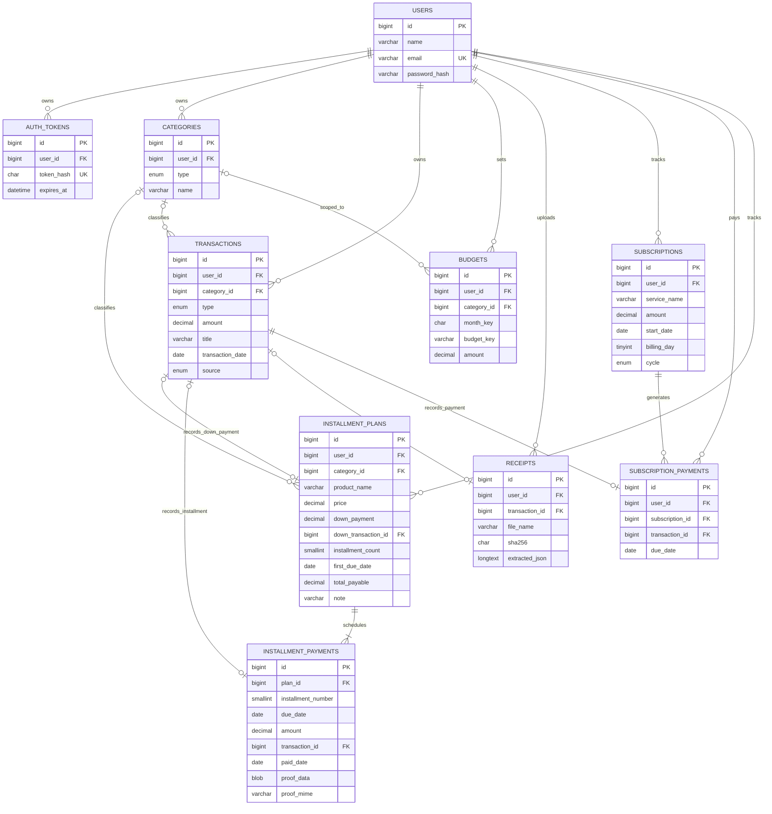

# ER Diagram — My Wallet AI

**หลักการออกแบบ**: รายรับและรายจ่ายอยู่ใน `transactions` ตารางเดียว (`type`) เพื่อรวมยอดสะดวก, `budgets.budget_key` ทำให้มีทั้งงบรวม (`total`) และตามหมวด (`cat_XX`) โดยไม่ซ้ำ, `subscription_payments` ใช้ unique ต่อ `(subscription_id, due_date)` ร่วมกับ row lock ของบริการและการตรวจรอบเดือน/ปีใน API เพื่อกันจ่ายซ้ำแม้เปลี่ยนวันตัดรอบ, `receipts` แยกรูปและข้อมูล AI ออกจากรายการที่ยืนยันแล้ว
